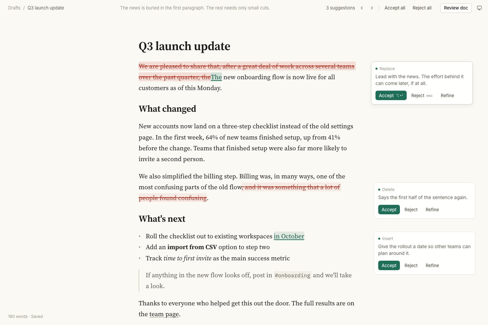

# Draft: a Markdown editor with an AI co-author



*Review doc on the sample document. This is real model output: two suggestions, shown inline (red struck = removed, green underlined = added), each with its reason in the margin. The document doesn't change until you accept. [Dark mode](docs/screenshot-dark.png), also real output, from a separate run.*

## Run it

Needs Node 20.12+ and an OpenRouter key.

```sh
npm ci
cp .env.example .env        # then put your key in OPENROUTER_API_KEY
npm run dev                 # http://localhost:3000
```

The two model variables in `.env.example` are optional; the defaults are the models described below.

Checks:

```sh
npm test                           # unit + API tests, OpenRouter mocked
npx playwright install chromium    # once, for the browser tests
npm run test:e2e                   # browser tests, API intercepted, nothing billed
npm run build
```

`npm run eval -- --dry-run` runs the model eval against a fake model (free). Without `--dry-run` it calls real models and costs money.

## What it does

- **Write Markdown** in a document-style editor. Markdown marks (`#`, `**`, `-`, `>`, backticks, link URLs) are hidden except on the line you're editing. The text underneath is always plain Markdown.
- **Review doc** (top right) reads the whole document and suggests up to five small edits, or none if the text is fine.
- **⌘K** asks about the paragraph under the cursor, or the selection: type an instruction or pick a preset (Tighten, Fix grammar, More formal, More casual, Clarify).
- **Each suggestion** has Accept, Reject and Refine. Refine takes a follow-up ("shorter", "more formal") and remembers earlier rounds.
- **Keep typing while it thinks.** Answers land on the right text even after you've edited above or around it.
- **Keys:** ⌥↵ accepts and Esc rejects when the cursor is inside a suggestion. ⌘Z undoes an accept. Tab still indents.
- The document is saved to your browser (localStorage). The first visit loads a sample document.

## How it works

**Anchoring.** The model never returns the whole document. It returns up to five `{quote, replacement, reason}` edits. The server looks for each quote by exact match. If a quote occurs zero times, or more than once, that edit is dropped and counted ("1 suggestion couldn't be placed"), never guessed. The text the quote and replacement share at the start and end is trimmed off, at word boundaries, so a one-word fix shows as a one-word diff. Offsets are UTF-16, as in JavaScript strings and CodeMirror. Code: `lib/server/locate.ts`.

**Mapping while you type.** Every request remembers the document as it was sent and records every edit made after that. When the answer arrives, each suggestion is moved through those edits (CodeMirror's `ChangeSet.mapPos`). Then it's re-checked: the text at the new position must still equal the quote, or the suggestion is dropped. Suggestions already on screen follow your edits the same way, and disappear if you edit inside them. Code: `lib/editor/mapping.ts`, `lib/editor/place.ts`, `components/Workspace.tsx`.

**Two models.**
- Review doc uses Claude Sonnet 5.5, with reasoning set to `low`, the lowest it accepts. Reviewing a whole document needs judgment: in the eval, Sonnet was the only model that fixed a buried lede with small edits.
- ⌘K and refine use Claude Haiku 5.5, with reasoning off. Those are small, scoped edits, where Haiku was as good and about 1 s faster.

Both are set in `lib/server/models.ts` and can be overridden with `OPENROUTER_MODEL_REVIEW` / `OPENROUTER_MODEL_EDIT`. The API key is only read by the server route (`app/api/suggest/route.ts`), and it's redacted from any error passed back.

**The eval.** `eval/` has three documents with real problems planted in them: a buried lede, a rambling paragraph, passive voice, typos and a vague claim. Each also has a paragraph that's already good, to catch over-editing. Checks are pass/fail, and `eval/reports/` keeps the side-by-side output for every model. All prompt text lives in one file, `lib/prompts.ts`.

**Where to look first.** `SPEC.md` has the decisions and the test list. `DESIGN.md` has the visual system. `CLAUDE.md` has the commands and the non-obvious rules.

## Left out on purpose

- **Auth, a database, real-time collaboration, deployment.** The brief asks for none of them. One person and one document in localStorage is enough to show the editing loop.
- **Fuzzy quote matching.** A suggestion in the wrong place is worse than a missing one, so unplaceable edits are dropped and reported.
- **Streaming.** The answer is a short JSON list; a shimmer on the text being worked on covers the wait.
- **A rendered preview pane.** Live preview (hidden marks) already makes the document read as a document.
- **Rate limiting.** The app runs locally on your own key, and each request is capped: 40k characters in, a 1200-token answer out (plus 1024 reasoning tokens for Sonnet).
- **Version history** beyond undo.

## How I used AI to build it

Built with Claude Code. The full sessions are in `ai-sessions/`, unedited except for masked keys.

- **Spec first.** No code until `SPEC.md` was agreed: the decisions, the request/response contract, and the test list. The UI started from `DESIGN.md` and a static mock, which I checked from screenshots in both themes and at phone width before anything was wired up.
- **The eval picked the models.** The first comparison showed Sonnet can't turn reasoning off. After changing two prompts (the note may only describe what the edits do; a buried lede means rewriting the opening), the second run showed what the split should be.
- **Tests as the bar.** Every task ended with `npm test`, `npm run test:e2e` and `npm run build` green. I also deliberately broke the code to make sure the important tests can fail.
- **A real run in the browser**, with a screenshot at every step, found bugs the tests didn't: refine rewriting a fragment into "In In the first week", and the cursor hidden under the top bar. Both are fixed.
- **A fresh review.** A separate agent with no context read the code and found seven issues, including two ⌘K race conditions. Each fix began with a test that failed without it.
- **Guardrails.** A Claude Code deny rule kept the agent from reading the key file, live API spend was capped per task, and every live run was rehearsed with mocks first.

## What it cost

About $0.064 of the $5 key: $0.057 read from OpenRouter's `/api/v1/key`, plus $0.006 for the last screenshot run, as reported by that call (the key's counter lags a few seconds):
- two model-comparison runs: $0.002, then $0.030
- browser walkthroughs and refine checks: $0.025
- the dark-mode screenshot (one Review doc): $0.006

Development and all tests run against mocks.

## With more time

- **Refine and neighbouring suggestions.** Refine widens its span to whole sentences, because rewriting trimmed fragments produced broken text. If another suggestion sits in that sentence and the rewrite reaches it, the new version is discarded (and the card says so). Better: tell the model which spans are off-limits, or merge the two suggestions.
- **Word-level diffs inside a replacement**, so text kept in the middle of a rewrite isn't shown as deleted and re-added.
- **Notes that match the edits.** Haiku's one-line notes sometimes describe more than its edits do. Generate the note from the edits that were placed, or check it against them.
- **A bigger eval:** more documents, several runs per case, latency spread rather than one sample.
- **Phone layout:** only the active suggestion's card shows under its paragraph. A bottom sheet would make moving between suggestions easier.
